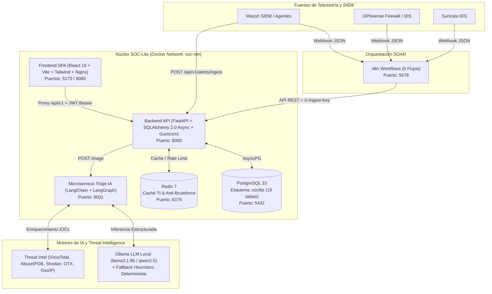

# 08 · Manual de Instalación y Despliegue (SOC-Lite)

## 1. Propósito y Alcance
El presente **Manual de Instalación y Despliegue** describe paso a paso los requisitos técnicos, la configuración del entorno, el levantamiento de contenedores, la inicialización de la base de datos y la verificación operativa del sistema **SOC-Lite: Triaje Automático de Alertas SOC con n8n, LangChain y LLM**.

---

## 2. Arquitectura de Despliegue y Árbol de Directorios

### 2.1 Diagrama de Arquitectura (Mermaid)



### 2.2 Árbol Completo de Directorios del Proyecto

```text
soc-lite/
├── .env                                    # Variables de entorno activas para despliegue
├── .env.example                            # Plantilla documentada de variables de entorno
├── docker-compose.yml                      # Orquestación completa de microservicios
├── README.md                               # Guía general del proyecto
├── backend/                                # API Principal (FastAPI + Python 3.12)
│   ├── Dockerfile                          # Multi-stage build seguro (usuario no-root soclite)
│   ├── requirements.txt                    # Dependencias del backend y reportería
│   ├── app/
│   │   ├── main.py                         # Punto de entrada ASGI, CORS, middlewares, /health
│   │   ├── api/
│   │   │   ├── deps.py                     # Inyección de dependencias, JWT y RBAC
│   │   │   └── v1/
│   │   │       ├── router.py               # Enrutador maestro /api/v1
│   │   │       └── routers/
│   │   │           ├── auth.py             # Login OAuth2, Refresh, Logout, MFA TOTP
│   │   │           ├── users.py            # CRUD de Usuarios y Roles (RBAC)
│   │   │           ├── alerts.py           # Ingesta idempotente, consulta, timeline
│   │   │           ├── triage.py           # Ejecución de triaje IA, feedback y métricas
│   │   │           ├── incidents.py        # Gestión de incidentes, contención y SLA
│   │   │           ├── dashboard.py        # KPIs ejecutivos, MTTT, MTTR, tendencias
│   │   │           ├── reports.py          # Exportación PDF, Word (.docx), Excel (.xlsx), CSV
│   │   │           └── audit.py            # Bitácora inmutable y verificación SHA-256
│   │   ├── core/
│   │   │   ├── config.py                   # Configuración tipada con Pydantic Settings
│   │   │   ├── security.py                 # Hashing bcrypt, JWT UUIDv4, cálculo risk_score
│   │   │   ├── exceptions.py               # Manejadores globales de errores con trace_id
│   │   │   └── logging.py                  # Logging estructurado JSON / Consola
│   │   ├── db/
│   │   │   └── session.py                  # Motor asíncrono SQLAlchemy + AsyncPG
│   │   ├── middleware/
│   │   │   └── audit_middleware.py         # Trazabilidad automática de peticiones HTTP
│   │   ├── models/                         # Modelos ORM (User, Role, Alert, Incident, AuditLog)
│   │   ├── schemas/                        # Contratos Pydantic v2 de entrada/salida
│   │   └── services/                       # Lógica de negocio (Audit, Triage, ReportService)
│   └── tests/                              # Suite de pruebas automatizadas (Pytest)
├── langchain-service/                      # Microservicio de Agente IA (LangChain + LangGraph)
│   ├── Dockerfile                          # Contenedor aislado (usuario no-root triage)
│   ├── requirements.txt                    # LangChain, LangGraph, Ollama, HTTPX, Gunicorn
│   └── app/
│       ├── main.py                         # Endpoints /health y POST /triage
│       ├── schemas.py                      # Esquemas estructurados del veredicto LLM
│       ├── agents/triage_agent.py          # Grafo de estados LangGraph + Fallback Heurístico
│       ├── chains/prompts.py               # Prompts del sistema (triage_v3, anti-injection)
│       └── tools/threat_intel.py           # Herramientas de enriquecimiento (VT, AbuseIPDB, GeoIP)
├── frontend/                               # Aplicación Web SPA (React 18 + TypeScript + Vite)
│   ├── Dockerfile                          # Build Node 20 + Runtime Nginx 1.27 Alpine
│   ├── nginx.conf                          # Servidor SPA + Reverse Proxy hacia /api/
│   ├── package.json                        # Dependencias React, Recharts, Lucide, Tailwind
│   ├── dist/                               # Bundle de producción precompilado y optimizado
│   └── src/
│       ├── api/                            # Clientes Axios con interceptores JWT
│       ├── components/                     # Layout, Badges, ProtectedRoute, PermissionGate
│       ├── context/AuthContext.tsx         # Estado global de sesión y permisos
│       └── pages/                          # Vistas: Login, Dashboard, Alerts, Incidents, Reports, AuditLog, Users, Roles
├── db/                                     # Persistencia Relacional
│   ├── schema.sql                          # DDL PostgreSQL 15 (19 tablas, 4 vistas, triggers SHA-256)
│   └── seed.sql                            # Semilla inicial (roles, 22 permisos, 6 usuarios, 5 alertas, incidente)
├── n8n/                                    # Automatización de Flujos SOAR
│   ├── soc_lite_triage_workflow.json       # Flujo principal: Webhook -> Enriquecimiento -> Triaje -> Ticket
│   ├── soc_lite_dedup_suppression_workflow.json
│   ├── soc_lite_sla_escalation_workflow.json
│   ├── soc_lite_metrics_aggregation_workflow.json
│   └── soc_lite_report_generation_workflow.json
└── docs/                                   # Documentación Técnica y Manuales (00 al 13)
```

---

## 3. Requisitos Previos

### 3.1 Requisitos de Hardware
| Componente | Mínimo (Modo Heurístico / API Externa) | Recomendado (Con Ollama LLM Local 8B) |
| :--- | :--- | :--- |
| **CPU** | 4 vCPU (x86_64 / ARM64) | 8 vCPU |
| **Memoria RAM** | 8 GB RAM | 16 GB RAM |
| **Almacenamiento** | 15 GB libres SSD | 40 GB libres NVMe SSD |
| **GPU (Opcional)** | No requerida (fallback determinista activo) | NVIDIA RTX con 8+ GB VRAM |

### 3.2 Requisitos de Software
1. **Sistema Operativo**: Windows 10/11 Pro/Enterprise (con WSL2), Ubuntu Server 22.04/24.04 LTS o Debian 12.
2. **Docker Engine / Docker Desktop**: versión `24.0+` con Docker Compose `v2.20+`.
3. **Navegador Web Moderno**: Google Chrome 120+, Microsoft Edge 120+ o Mozilla Firefox 120+.
4. *(Opcional para desarrollo local sin Docker)*: Python `3.12+`, Node.js `20 LTS` y PostgreSQL `15`.

---

## 4. Configuración del Archivo `.env`

En la raíz del proyecto (`soc-lite/.env`) se definen las variables de entorno críticas:

```ini
APP_NAME=SOC-Lite
APP_VERSION=1.0.0
ENVIRONMENT=development
SECRET_KEY=soclite-jwt-secret-key-change-in-production-2025-demo
INGEST_API_KEY=demo-ingest-key-2025
INTERNAL_SERVICE_TOKEN=soclite-internal-service-token-2026

POSTGRES_HOST=soc-lite-postgres
POSTGRES_PORT=5432
POSTGRES_USER=soclite
POSTGRES_PASSWORD=soclite
POSTGRES_DB=soclite
POSTGRES_SCHEMA=soclite

REDIS_URL=redis://soc-lite-redis:6379/0
LANGCHAIN_SERVICE_URL=http://soc-lite-langchain:8001
LLM_PROVIDER=ollama
OLLAMA_BASE_URL=http://host.docker.internal:11434
OLLAMA_MODEL=llama3.2:3b
```

---

## 5. Instalación y Despliegue Paso a Paso

### Paso 1: Crear la Red de Contenedores Aislada
```powershell
docker network create soc-net
```

### Paso 2: Levantar Base de Datos PostgreSQL 15 y Cargar Esquema + Semilla
```powershell
docker run -d --name soc-lite-postgres --network soc-net `
  -p 5432:5432 `
  -e POSTGRES_USER=soclite `
  -e POSTGRES_PASSWORD=soclite `
  -e POSTGRES_DB=soclite `
  postgres:15-alpine

# Inicializar las 19 tablas, 4 vistas, funciones y cadena de auditoría SHA-256
Get-Content .\db\schema.sql -Raw | docker exec -i soc-lite-postgres psql -U soclite -d soclite

# Cargar los roles, permisos, usuarios de demostración y alertas iniciales
Get-Content .\db\seed.sql -Raw | docker exec -i soc-lite-postgres psql -U soclite -d soclite
```

### Paso 3: Levantar Caché Redis 7
```powershell
docker run -d --name soc-lite-redis --network soc-net -p 6379:6379 redis:7-alpine
```

### Paso 4: Construir y Ejecutar el Microservicio de Triaje IA (`langchain-service`)
```powershell
docker build -t soc-lite-langchain .\langchain-service
docker run -d --name soc-lite-langchain --network soc-net -p 8001:8001 `
  -e OLLAMA_BASE_URL=http://host.docker.internal:11434 `
  -e OLLAMA_MODEL=llama3.2:3b `
  -e LOG_LEVEL=INFO `
  soc-lite-langchain
```

### Paso 5: Construir y Ejecutar el Backend API (`backend`)
```powershell
docker build -t soc-lite-backend .\backend
docker run -d --name soc-lite-backend --network soc-net -p 8000:8000 `
  -e POSTGRES_HOST=soc-lite-postgres `
  -e POSTGRES_PORT=5432 `
  -e POSTGRES_DB=soclite `
  -e POSTGRES_USER=soclite `
  -e POSTGRES_PASSWORD=soclite `
  -e REDIS_URL=redis://soc-lite-redis:6379/0 `
  -e LANGCHAIN_SERVICE_URL=http://soc-lite-langchain:8001 `
  -e SECRET_KEY=soclite-jwt-secret-key-change-in-production-2025-demo `
  -e INGEST_API_KEY=demo-ingest-key-2025 `
  soc-lite-backend
```

### Paso 6: Levantar el Frontend Web SPA con Proxy Inverso Nginx (`frontend`)
```powershell
docker run -d --name soc-lite-frontend --network soc-net `
  -p 5173:80 -p 8080:80 `
  -v "${PWD}/frontend/dist:/usr/share/nginx/html:ro" `
  -v "${PWD}/frontend/nginx.conf:/etc/nginx/conf.d/default.conf:ro" `
  nginx:1.27-alpine
```

---

## 6. Verificación de la Instalación (Health Checks)

Una vez iniciados los contenedores, verifique que todos se encuentren en estado `Up` y `healthy`:

```powershell
docker ps --format "table {{.Names}}\t{{.Status}}\t{{.Ports}}"
```

### Endpoints de Verificación Directa:
1. **Aplicación Web Frontend (React SPA)**: [http://localhost:5173](http://localhost:5173) (también disponible en [http://localhost:8080](http://localhost:8080))
2. **Documentación Interactiva OpenAPI / Swagger UI**: [http://localhost:8000/docs](http://localhost:8000/docs)
3. **Health Check del Backend**: `GET http://localhost:8000/api/v1/health` → devuelve `"status": "ok"` y estado de PostgreSQL.
4. **Health Check del Microservicio LangChain**: `GET http://localhost:8001/health` → devuelve `"status": "ok"`.

---

## 7. Mantenimiento, Respaldo y Restauración

### 7.1 Respaldo de Base de Datos (Backup)
```powershell
docker exec soc-lite-postgres pg_dump -U soclite -n soclite -Fc soclite > soclite_backup_$(Get-Date -Format 'yyyyMMdd').dump
```

### 7.2 Verificación de Integridad de la Bitácora de Auditoría
El sistema incluye un encadenamiento criptográfico tipo blockchain (`hash_prev` + `hash_self` con SHA-256). Para verificar que ningún registro de auditoría ha sido alterado:
```powershell
Invoke-RestMethod -Uri "http://localhost:5173/api/v1/audit/verify-chain" -Headers @{ Authorization = "Bearer <TOKEN>" }
# Respuesta esperada: {"checked": 38, "broken_links": [], "intact": true}
```
